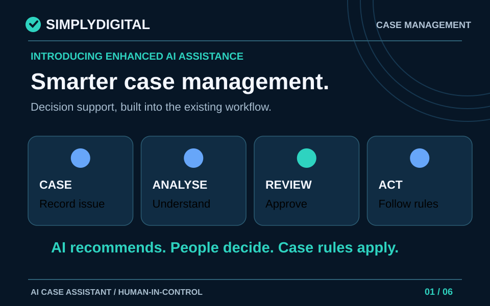
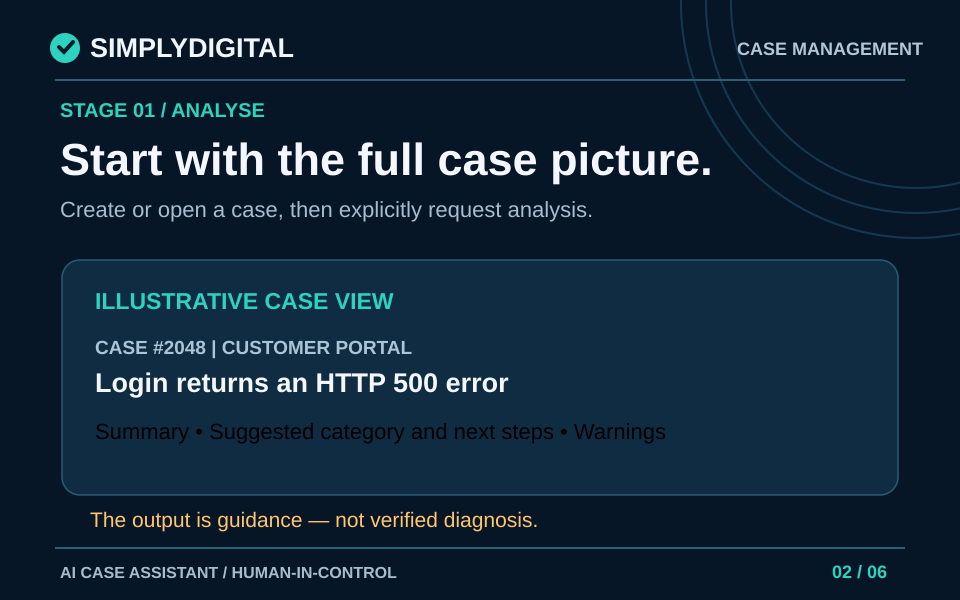
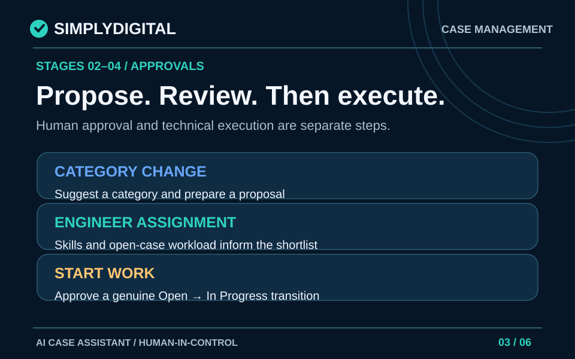
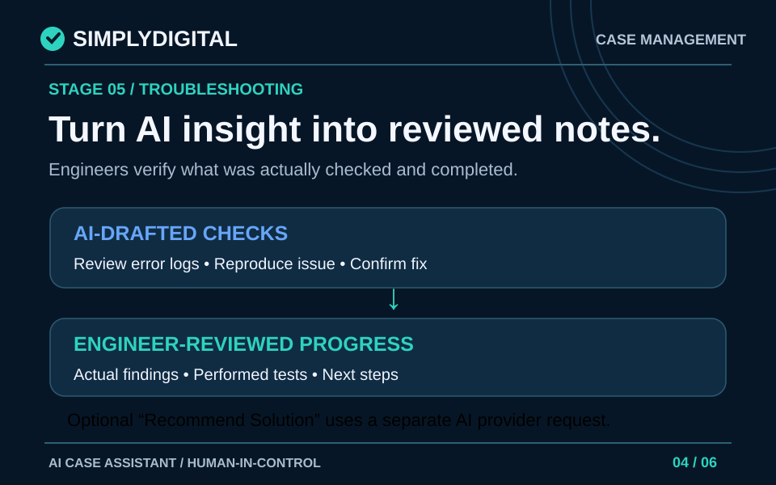
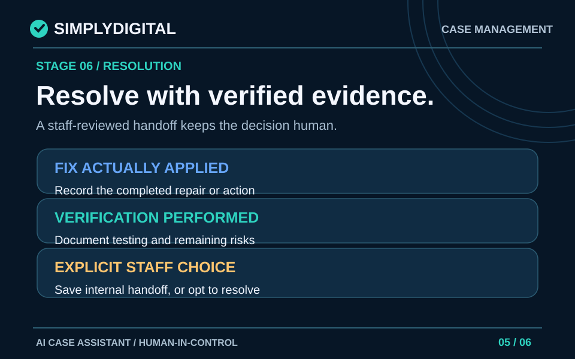
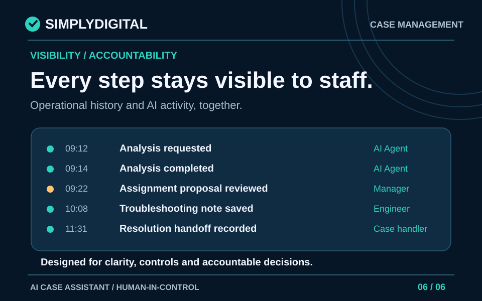

# Case Management Application


## AI Case Assistant — Human-in-Control



<details>
<summary><strong>Explore the AI Case Assistant showcase — all six stages</strong></summary>











</details>

**AI recommends. People decide. Case rules apply.** AI Assistance is optional and remains in beta. Read the [AI Assistance User and Management Guide](docs/AI_ASSISTANCE_USER_AND_MANAGEMENT_GUIDE.md) for workflows, safeguards and deployment considerations.


A Laravel-based management platform for Simplydigital operations, built around modular packages in `packages/Simplydigital` and powered by Laravel, Livewire, and Tailwind.

This repository is a monorepo-style application with a Laravel application shell and several feature packages that can be developed and tested independently while still sharing the same app runtime.

> **Beta testing:** The current version is ready for real-use testing, but remains in the beta testing stage. If you are interested in helping, you are welcome to clone the repository, run the application, and test it.

## Stack

- PHP 8.3+ (Laravel 13)
- Laravel 13
- Livewire 4
- Livewire Flux 2
- Tailwind CSS 4
- Vite for frontend assets
- Composer path-based package development
- PHPUnit for automated testing

## Overview

The application includes operational modules for:

- Case management
- A customer portal
- Engineer management
- User management
- Event planning
- Stock management, including part requests, orders, dispatches, and receipts
- Expense claims
- Notifications
- File upload handling
- Table and workflow views for managing cases
- An AI-powered Case Assistant helper

The business logic and UI are primarily delivered through package modules, with the main `/app` layer handling the Laravel application shell, authentication and bootstrap concerns.

## AI Assistance: user and management guide

For an explanation of how AI Assistance works alongside normal manual case handling, including the case lifecycle, approval safeguards, limitations and an organisational adoption checklist, read the [AI Assistance User and Management Guide](docs/AI_ASSISTANCE_USER_AND_MANAGEMENT_GUIDE.md).

Administrators deploying the AI Assistant on Ubuntu can use the [Ubuntu Supervisor Queue Worker Guide](docs/UBUNTU_SUPERVISOR_QUEUE_WORKER_GUIDE.md) for permanent background processing and troubleshooting `ERROR (spawn error)`.

The AI features are optional and controlled by provider configuration, role permissions, human approval and separate execution switches. The application is still in beta; organisations should validate privacy, security, operations and cost before rollout.

## Project structure

```text
.
├── app/
│   ├── Console/
│   ├── Http/
│   ├── Livewire/
│   ├── Models/
│   ├── Providers/
│   └── ...
├── bootstrap/
├── config/
├── database/
├── packages/
│   └── Simplydigital/
│       ├── AIManagement/
│       ├── CaseManagement/
│       ├── EngineerManagement/
│       ├── EventPlannerManagement/
│       ├── Expenses/
│       ├── FileUploadManagement/
│       ├── NotificationManagement/
│       ├── StockManagement/
│       └── UserManagement/
├── public/
├── resources/
├── routes/
├── storage/
├── tests/
├── artisan
├── composer.json
├── package.json
├── phpunit.xml
├── vite.config.js
├── .env.example
└── README.md
```

## Package architecture

The project is structured around reusable package directories under `packages/Simplydigital`, for example:

- `AIManagement` — AI service integrations and case-assistant tooling
- `CaseManagement` — customer portal and case workflows, including table and workflow views, dashboard, SLA logic, and site visits
- `EngineerManagement` — engineers, skills, certificates and related views
- `EventPlannerManagement` — event scheduling and planner tooling
- `Expenses` — expense claim workflows
- `FileUploadManagement` — upload, storage and file handling workflows
- `NotificationManagement` — notifications and communication features
- `StockManagement` — part requests, orders, dispatches, and receipt tracking
- `UserManagement` — access, roles, and user administration

These packages are registered through Composer path repositories in the root `composer.json`.

## Guided installer (Ubuntu/Linux)

Prefer a preflight-checked, interactive installer? Download and inspect **[install-case-management.py](scripts/install-case-management.py)** or **[install-case-management.sh](scripts/install-case-management.sh)** . It checks software versions and PHP extensions, stops and explains any missing requirements, then prompts for the clone directory and branch before installing Composer/npm dependencies and building assets.

```bash
curl -fL -o install-case-management.py \
  https://raw.githubusercontent.com/YusainiU/Case-Management-Application/feature/ai-agent-approvals-v1/scripts/install-case-management.py
python3 install-case-management.py --check-only
python3 install-case-management.py
```

For bash script, after download run ..

```
chmod u+x install-case-management.sh
./install-case-management.sh
```

It **does not** automatically migrate/seed your database, publish assets, or configure a production server. Complete those steps when prompted, then use `composer run dev` locally. See the [Guided Local Deployment Guide](docs/GUIDED_LOCAL_DEPLOYMENT.md) for a detailed walkthrough.

## Requirements

Before running the project, ensure you have:

- PHP 8.3 or newer
- Composer
- Node.js 20.19.x or 22.12+ (Vite 8) and npm 10+
- A local database (MySQL is configured and supported)
- An `.env` file for local application configuration

## How to install

1. Clone the repository and enter the project directory:

```bash
git clone <repository-url>
cd Case-Management-Application
```

2. Install PHP dependencies:

```bash
composer install
```

3. Install frontend dependencies:

```bash
npm install
```

4. Create your local environment file:

```bash
cp .env.example .env
```

Then edit `.env` and set values for:

- application URL
- database connection and credentials
- mail configuration
- AI provider configuration (if using the AI management features)

Example settings:

```env
APP_NAME="Case Management"
APP_ENV=local
APP_DEBUG=true
APP_URL=http://localhost

DB_CONNECTION=mysql
DB_HOST=127.0.0.1
DB_PORT=3306
DB_DATABASE=case_management
DB_USERNAME=root
DB_PASSWORD=

CACHE_DRIVER=file
SESSION_DRIVER=file
QUEUE_CONNECTION=database

AUDIT_AUTO_MIGRATION=true
AUDIT_RETENTION_ENABLED=false
AUDIT_RETENTION_DAYS=365
AUDIT_RETENTION_STRATEGY=delete
AUDIT_RETENTION_BATCH_SIZE=1000

FILEUPLOAD_DISK=local
FILEUPLOAD_ROOT=uploads
FILEUPLOAD_MAX_SIZE=10240

AI_MANAGEMENT_PROVIDER=openai
AI_MANAGEMENT_MODEL=gpt-4o-mini
AI_CASE_ASSISTANT_ENABLED=true
OPENAI_BASE_URL=https://api.openai.com/v1
OPENAI_API_KEY=
```

5. Generate the application key:

```bash
php artisan key:generate
```

6. Run the database migrations:

```bash
php artisan migrate
```

7. Seed the database with the required initial account and demo data:

```bash
php artisan db:seed
php artisan db:seed --class=DemoDatabaseSeeder
```

`DatabaseSeeder` creates the initial Super Admin account required to log in:

| Username | Password |
| --- | --- |
| `admin@example.com` | `password123` |

**Change the Super Admin username and password immediately after your first login.** These are default credentials and should not be left in place.

`DemoDatabaseSeeder` creates sample users, customers, suppliers, and products for testing. It is intended for non-production environments and will refuse to seed demo data in production.

8. Create the public storage symlink so uploaded documents can be accessed for download:

```bash
php artisan storage:link
```

9. Build frontend assets for the first time:

```bash
npm run build
```

10. Start the app in development mode:

```bash
composer run dev
```

This starts Laravel, the queue worker, logs, and Vite together.

If you prefer to run pieces separately:

```bash
php artisan serve
npm run dev
```

## Typical local workflow

- Backend and routes: `php artisan serve`
- Frontend assets: `npm run dev`
- Database migration updates: `php artisan migrate`
- Package package-level changes: edit files under `packages/Simplydigital/*`
- Production asset build: `npm run build`

## Contributing

1. Create a feature branch from the main branch.
2. Make changes in the relevant package or app layer.
3. Add or update tests for logic and behavior changes.
4. Run the smallest relevant test suite before submitting changes.

## Notes

This repository is intentionally modular rather than a single monolithic app. That helps keep domain logic organized while allowing package-level development inside one Laravel application shell.

If you are working on a specific domain, start in the corresponding folder under `packages/Simplydigital` and keep package boundaries consistent with the surrounding architecture.
